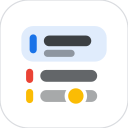

<p align="center"></p>

# Agenda

[](https://github.com/jechton/calendar-widget/actions/workflows/ci.yml)
[](https://github.com/jechton/calendar-widget/releases)
[](https://apps.obtainium.imranr.dev/redirect?r=obtainium://add/https://github.com/jechton/calendar-widget)

Android home screen calendar widget. Kotlin, Jetpack Compose and Glance, Material 3 with dynamic color.
Reads the calendars already on the phone (Google, Samsung, etc.), so there is no sign-in.

**Filtering**

- Hides duplicate events across calendars: same title, start and end
- Optional regex list that is ignored when comparing titles, so "Standup (Room 4)" and "Standup" merge
- When merging, keep the event with the most info (location, notes, longest title) or the shortest title
- Hides events once they have ended, with an optional delay (e.g. 60 min). Each calendar can override the delay or never hide
- Or dim them instead, with their own cutoff
- Per-calendar show/hide, calendar colors, all-day events, declined events hidden
- The settings screen lists what is being merged right now, to help tune regexes

**Look**

- Cards or List layout (colour stripes, day dividers, Samsung-style second line with time range and place)
- Presets: Cards, Samsung, Compact, Glass
- Light, dark or system theme, background opacity, corner radius, spacing, text size, date column width
- Events per day limit, one-line cards, optional end times, week labels, description line
- Live preview in the settings screen over your wallpaper

**Use**

- Tap an event to open it in your calendar app. The + button creates a new event
- "Join" link for Meet, Zoom, Teams and Webex events
- Days with nothing on show "No events". With nothing in range, the widget names the next upcoming event

Not in yet: Google Tasks. Android has no public provider for them, so it needs the Google Tasks API and sign-in.
Settings are global, not per widget.

## How the widget stays current

A WorkManager job redraws it at the moment the next event is due to drop off (end time plus offset) and at midnight.
Calendar changes, clock changes and date rollover trigger a redraw, and a 15 minute job covers missed broadcasts.

## Build

```sh
nix develop                 # JDK 17 + Android SDK 35 + adb
./gradlew testDebugUnitTest # dedupe/filter logic
./gradlew assembleDebug     # app/build/outputs/apk/debug/app-debug.apk
```

With direnv: `direnv allow`, then `agenda build`, `agenda install`, `agenda run`.
On NixOS pass `-Pandroid.aapt2FromMavenOverride=$ANDROID_HOME/build-tools/35.0.0/aapt2` outside the dev shell.
`./gradlew ktlintFormat` fixes style; CI runs `ktlintCheck`, unit tests and `assembleDebug`.

## Releasing

Same as kimai-app: every push to `main` computes the next version from Conventional Commits (git-cliff) and publishes
a signed APK. Set repo secrets `RELEASE_KEYSTORE_BASE64`, `RELEASE_KEYSTORE_PASSWORD`, `RELEASE_KEY_ALIAS`,
`RELEASE_KEY_PASSWORD`. PR titles must be Conventional Commits.

## Layout

```
app/src/main/java/app/agenda/
  domain/   models and EventFilter (dedupe, hide finished, day grouping). Pure Kotlin, unit tested
  data/     CalendarContract reader, settings storage
  widget/   Glance widget
  work/     refresh scheduling and broadcast receiver
  MainActivity.kt, SettingsViewModel.kt   settings UI
```
